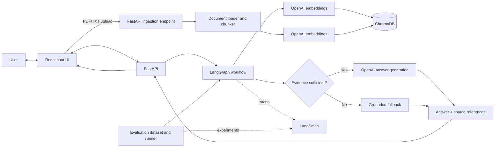

# Architecture and design decisions

## System diagram

## Request workflow

1. The React UI submits the user's question to `POST /chat`.
2. FastAPI invokes the compiled LangGraph state graph.
3. The retrieval node embeds the query and retrieves the three nearest chunks from ChromaDB.
4. The evidence-check node asks the chat model whether the retrieved text directly supports an answer.
5. LangGraph routes supported questions to answer generation and unsupported questions to an abstention response.
6. FastAPI returns the answer, evidence flag, and de-duplicated source filename/page references. The UI displays those references separately from the answer.

## Ingestion workflow

The UI uploads PDF/TXT documents to FastAPI. The loader extracts text and splits it into 300-character chunks with 50-character overlap. OpenAI embeddings are stored in a persistent local Chroma collection. Re-uploading the same path replaces its prior chunks.

## Design decisions and trade-offs

- **ChromaDB** keeps the prototype easy to run locally without provisioning a hosted vector service. It is not configured for multi-user access or production-grade operations.
- **`CHROMA_PATH`** can be set in `.env` to select the local ChromaDB directory; otherwise the repository-root `chroma_db` directory is used.
- **OpenAI embeddings and `gpt-4o-mini`** provide a simple single-provider setup. The project requires network access and should only process data approved for that provider.
- **Evidence-check routing** makes abstention an explicit workflow path rather than relying only on the answer prompt. It adds a model call and should be evaluated for both false accepts and false abstentions.
- **LangGraph state** carries the question, retrieved `Document` objects, evidence decision, and final answer through the graph. The graph is currently stateless between chat turns.
- **LangSmith** captures traces and evaluation experiments for debugging. Traces can contain prompts, model output, and retrieved text; tracing should be disabled for unapproved data.
- **Evaluation isolation** uses a temporary ChromaDB containing the sample handbook only, avoiding accidental tracing of unrelated local uploads.
- **React + FastAPI** separates the user-facing interface from document ingestion and RAG orchestration.

## Current scope and follow-up

The app is a single-user local prototype. Authentication/authorization, document access controls, conversation persistence, deployment, and scalable vector storage are not implemented. Before production use, add those controls and a policy for retention and redaction of traces and uploaded documents.
